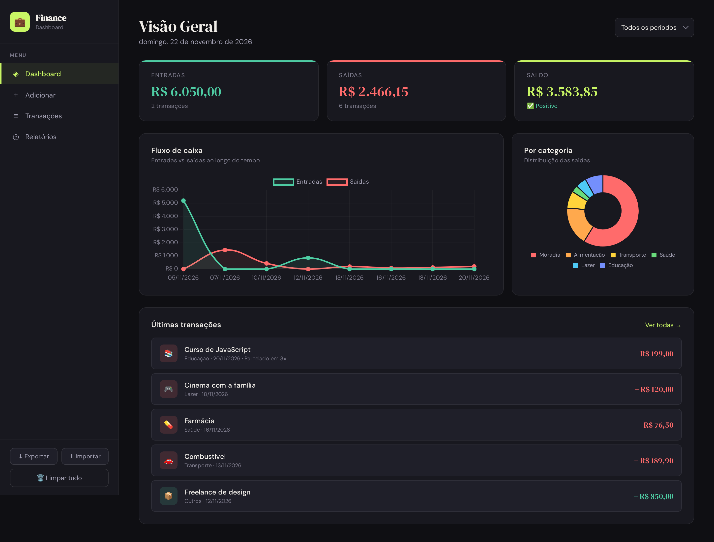
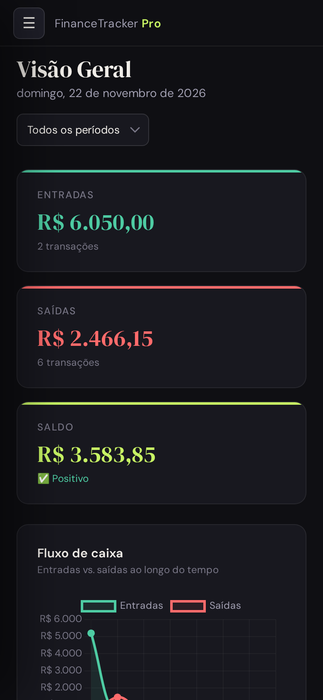

# FinanceTracker Pro

**Dashboard pessoal de finanças em HTML, CSS e JavaScript puro.**


Registro de entradas e saídas, saldo em tempo real, gráficos e relatórios — tudo no navegador, sem backend e sem cadastro. O projeto nasceu como primeiro trabalho de desenvolvimento web, para praticar estruturação de HTML, um sistema de design em CSS e manipulação de estado em JavaScript.



<p align="center">
  
</p>

## Funcionalidades

**Dashboard**
- Cards de entradas, saídas e saldo, com contagem de transações e indicador de saldo positivo ou negativo.
- Filtro de período: todos os períodos, este mês ou últimos sete dias.
- Gráfico de linha com o fluxo de caixa (entradas vs. saídas) agrupado por data.
- Gráfico de rosca com a distribuição das saídas por categoria.
- Lista das cinco transações mais recentes, ordenadas por data.

**Adicionar**
- Descrição, valor, categoria, data (padrão: hoje) e observação opcional.
- Valor aceita vírgula ou ponto: `1.234,56`, `1234,56` e `1234.56` são interpretados igual.
- Botões separados para registrar entrada ou saída.
- Validação de descrição e valor, com mensagem de erro no formulário.
- Confirmação por toast e limpeza automática dos campos após o registro.

**Transações**
- Histórico completo ordenado por data, do mais recente para o mais antigo.
- Busca por descrição e filtros por tipo (entrada/saída) e por categoria.
- Exclusão individual de cada transação.

**Relatórios**
- Resumo de entradas, saídas, saldo e total de transações.
- Taxa de comprometimento da renda (saídas sobre entradas).
- Ranking de gastos por categoria, com barras proporcionais.
- As cinco maiores despesas registradas.

**Backup e restauração**
- Exportação de todo o histórico em JSON, com data no nome do arquivo.
- Importação do JSON exportado, com validação de cada transação e confirmação antes de substituir os dados atuais.

**Outros**
- Persistência automática no `localStorage`: os dados sobrevivem ao recarregamento da página.
- Layout responsivo com menu lateral em drawer, botão de abrir/fechar, overlay e fechamento por `Esc`.
- Navegação por teclado nas seções e link "Pular para o conteúdo".
- Botão "Limpar tudo" com confirmação antes de apagar o histórico.
- Tema escuro, tipografia DM Serif Display + DM Sans e números tabulares nos valores.

## Stack

| Camada | Escolha |
| --- | --- |
| Interface | HTML5 sem framework |
| Estilo | CSS puro com variáveis de design (`:root`), Grid e Flexbox |
| Lógica | JavaScript ES6, organizado como módulo IIFE (`App`) |
| Gráficos | Chart.js via CDN (versão mais recente) |
| Persistência | `localStorage` |
| Fontes | Google Fonts (DM Serif Display e DM Sans) |

Sem etapa de build e sem dependências instaladas localmente: os dois recursos externos (Chart.js e as fontes) vêm por CDN.

## Estrutura

```text
.
├── index.html          # marcação das quatro seções e do menu mobile
├── style.css           # design tokens, layout, componentes, drawer e responsividade
├── script.js           # estado, persistência, cálculos, gráficos, filtros e backup
├── preview.png         # captura do dashboard usada neste README
└── preview-mobile.png  # captura da versão mobile
```

O `script.js` expõe apenas o necessário para os atributos `onclick` do HTML: `adicionar`, `excluir`, `limparTudo`, `atualizarTudo`, `renderizarLista`, `navegarPara`, `exportar` e `importar`. O restante — estado, cálculos e renderização — fica encapsulado na IIFE.

## Como executar

Não há instalação. Basta abrir o `index.html` no navegador. Para servir por HTTP (recomendado, e necessário se você quiser usar o projeto a partir de outro dispositivo na mesma rede):

```bash
python3 -m http.server 8000
# abra http://localhost:8000
```

O `localStorage` é vinculado à origem: abrir via `file://` e via `http://localhost` cria dois armazenamentos separados. Escolha um modo e mantenha.

## Como os dados são guardados

Cada transação é um objeto com `id`, `tipo` (`entrada` ou `saida`), `descricao`, `valor` numérico, `categoria`, `data` no formato ISO (`AAAA-MM-DD`) e `observacao`. O array completo é serializado em JSON na chave `finance_transacoes` do `localStorage`, regravado a cada inclusão, exclusão ou limpeza.

A exportação gera um arquivo `finance-tracker-AAAA-MM-DD.json` com o formato:

```json
{
  "app": "finance-tracker-pro",
  "versao": 1,
  "exportadoEm": "2026-11-22T20:00:00.000Z",
  "transacoes": [
    {
      "id": "1732300000000",
      "tipo": "entrada",
      "descricao": "Salário",
      "valor": 5200,
      "categoria": "salario",
      "data": "2026-11-05",
      "observacao": "Pagamento mensal"
    }
  ]
}
```

A importação aceita esse arquivo ou um array direto de transações. Cada item passa por validação; ids são regenerados e campos desconhecidos são descartados. A operação substitui todo o histórico atual, mediante confirmação.

Textos digitados são escapados antes de entrar no DOM, e o valor é validado como número positivo. Não há servidor, conta de usuário, telemetria ou requisição com os seus dados — as únicas conexões externas são o Chart.js e as fontes. Limpar os dados do site no navegador apaga o histórico.

## Limitações e próximos passos

- Uma única moeda (real brasileiro) e uma única carteira; não há contas separadas.
- A importação substitui o histórico inteiro; ainda não há mesclagem entre arquivos.
- Sem transações recorrentes, orçamentos, metas ou parcelamento.
- Categorias são fixas no código; ainda não há editor de categorias.
- Os dados ficam no navegador e no dispositivo: não sincronizam entre máquinas.
- Sem autenticação — o projeto é de uso pessoal e local.

Evoluções naturais: mesclagem na importação, filtros de data personalizados, categorias editáveis, transações recorrentes e, se o projeto crescer, um backend com autenticação.

## Autor

Desenvolvido por **João Paulo** ([@Joaopaulo-devv](https://github.com/Joaopaulo-devv)).
